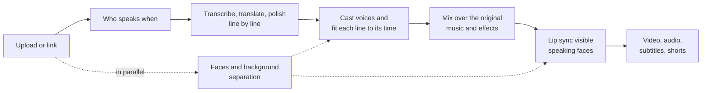

# Dubloom

An AI dubbing studio for Indian languages, built on India's sovereign models. Upload a video or paste a link, pick a language, and Dubloom transcribes the dialogue, translates it, voices every speaker with a matching studio voice, fits each line to the original timing, and redraws the speakers' lips to match the new words. The result is an editable project: change a line, a voice or a delivery style, and only what changed is rendered again.

Built with **FastAPI + Vue 3**. Speech runs on Bodhan **Indic-Transcribe, Indic-Translate and Indic-Speak**; Gemini (through OpenRouter) edits the script and reviews who is speaking; local GPU workers handle speakers, faces, audio separation and lip sync.

## Key features

- **Any of 23 languages to any other** (22 Indian languages plus English), from an upload or a video link, optionally only a part of the video.
- **Live script:** each line is transcribed, translated and polished the moment it is heard, so the script fills in while the dub is made.
- **Every speaker gets a voice:** DiariZen finds who speaks when, Gemini re-listens to check it, and voices are cast by gender, voice pitch and genre. Faces on screen correct the casting.
- **A script editor that keeps the meaning:** Gemini adapts each translation to the content's genre and register (a lecture, a film, the news), keeps English technical terms as people say them, and never pads lines.
- **Lines that fit their time:** a line that runs long or short is rewritten and re-voiced to land within 0.9-1.1x of the original pace. Lines that still don't fit are flagged under "Worth a look".
- **Lip sync only where it shows:** LatentSync 1.6 redraws only the visible, speaking faces (InsightFace and active-speaker detection; frames with hands over the mouth are skipped), then GFPGAN and Real-ESRGAN restore the mouths. Works up to 4K. Wav2Lip and a voice-only mode run without a GPU.
- **The original soundtrack stays:** music and effects are separated from the voices (Mel-Band RoFormer or Demucs), or the original mix is ducked under the dub.
- **Edit like a studio:**
  - edit any line yourself, or ask the AI and compare its suggestion word by word with the original;
  - try alternate takes and per-line delivery styles;
  - every change is kept as a version you can play back, and every line keeps its own history.
- **Export:** full-quality video, the dubbed audio, SRT/VTT subtitles in either language, and vertical shorts that follow the speaker's face.
- **Built to keep going:** jobs resume where they stopped, model rate limits are waited out, and paid model results are cached so a re-render costs only what changed.

## How it works



`process_job()` in [`backend/jobs/pipeline.py`](backend/jobs/pipeline.py) runs these steps in order, one module per stage in [`backend/jobs/stages/`](backend/jobs/stages/).

## Requirements

- Linux/Bash, Git, curl and Python 3.12 with pip/venv.
- FFmpeg 7 with Rubber Band and subtitle/libass support, plus ffprobe on `PATH`; Node.js 22+ and npm.
- NVIDIA CUDA GPU for LatentSync; voice-only and Wav2Lip provide CPU options.
- Bodhan ASR, translation and TTS keys; an OpenRouter key for script editing, review and configured model fallbacks.
- Internet access and disk space for model weights. Setup creates isolated Python 3.10/3.12 model environments using `uv`.

## Install and run

```bash
git clone https://github.com/AvnishJ29/Dubloom.git
cd Dubloom
python3.12 -m venv .venv             # explicitly select the studio's Python version
cp -n .env.example .env              # fill in the keys listed below
scripts/setup_models.sh cuda         # use "cpu" for a CPU setup
./run.sh
```

Open **http://localhost:8001**. `run.sh` installs the studio dependencies when needed, builds a missing frontend, prepares fallback diarization models and starts the API/UI. For a later UI rebuild, run `REBUILD_UI=1 ./run.sh`.

## Configuration

All settings are described in [`.env.example`](.env.example). Keep actual credentials in the untracked `.env`.

| Setting | Purpose |
| --- | --- |
| `BODHAN_ASR_API_KEY`, `BODHAN_TRANSLATE_API_KEY`, `BODHAN_TTS_API_KEY` | Speech recognition, translation and voices |
| `OPENROUTER_API_KEY` | Script work, speaker review and available fallbacks |
| `BODHAN_ONLY` | Set `true` to keep ASR, translation and studio voices on Bodhan; reviewer/script work can still use OpenRouter |
| `STUDIO_PASSWORD` | Optional studio sign-in |
| `HOST`, `PORT` | Bind address and server port; defaults `0.0.0.0:8001` |
| `MAX_VIDEO_HEIGHT` | Source resolution limit; example config is 720, set 2160 for up to 4K |
| `LIP_SYNC_MODEL` | Blank/default selection, `latentsync`, `wav2lip`, `wav2lip_gan` or `none` |
| `YTDLP_NODE` | Node 22+ executable when the Node on `PATH` is older |
| `YTDLP_COOKIES` | Optional `cookies.txt` from a signed-in browser, for sites (YouTube) that ask servers to sign in |
| `JOBS_DIR` | Persistent project/media storage; defaults to `jobs/` |

Timing, background audio, concurrency, model paths and upload limits are also configurable in that file.

## Use the studio

1. Paste a video link or upload a file. Choose the language, lip-sync/voice-only mode and optional clip range.
2. Review the result. Edit script lines, voices, delivery or takes, then re-render.
3. Download video, audio or subtitles, or create a short. The sidebar lists every version you made; earlier versions stay playable.

The pipeline reuses unchanged speech, model analysis and rendered spans. Processing time depends on video length, faces, hardware and provider limits.

## Code structure

| Path | Responsibility |
| --- | --- |
| `main.py`, `run.sh` | Application entry point and launcher |
| `backend/api/`, `backend/config.py`, `backend/models.py` | HTTP routes (one router per concern), environment settings and shared records |
| `backend/jobs/` | `pipeline.py` runs the stages in `stages/` (source, speakers, script, voicing, mix, render) in order; job store, cancellation, GPU slots, render history and takes |
| `backend/media/` | Media input, audio processing, timing, validation, subtitles and shorts |
| `backend/speech/` | ASR, translation, script supervision, TTS and duration fitting |
| `backend/speakers/` | Diarization, speaker profiles, face evidence and gender analysis |
| `backend/voices/` | Voice catalogue, library data, casting and synthesis routing |
| `backend/providers/` | Bodhan/OpenRouter clients, pacing and usage accounting |
| `backend/rendering/` | Face analysis, lip-sync engines (LatentSync, Wav2Lip), face restoration and final assembly |
| `backend/workers/` | Model processes running in isolated environments |
| `backend/tests/` | Backend regression tests |
| `frontend/src/components/` | Vue screens and reusable controls |
| `frontend/src/lib/` | API client, formatting, timing and history helpers |
| `frontend/src/styles/`, `frontend/src/style.css` | Styles by concern and their ordered entry point |
| `frontend/tests/`, `frontend/scripts/` | Client tests and formatting tools |
| `scripts/`, `scripts/systemd/` | Model setup, deployment and optional systemd service |
| `fonts/` | Noto fonts for every script, used when a short burns in the dubbed lines (SIL OFL, see `fonts/OFL.txt`) |
| `Wav2Lip/`, `backend/vendor/` | Vendored lip-sync and audio-normalization implementations |
| `models/`, `third_party/`, `.venv*/`, `gfpgan/weights/` | Local weights, checkouts and environments; not committed |
| `jobs/`, `logs/`, `scratch/` | Runtime data; not committed |

To read the code, start with `process_job()` in [`backend/jobs/pipeline.py`](backend/jobs/pipeline.py): it lists the whole pipeline in order, one call per stage. Each stage module in `backend/jobs/stages/` then calls the feature packages above.

Generated `frontend/dist/` assets are built locally and are not committed. `run.sh` builds them when missing. Keep source assets in `frontend/public/` and application code in `frontend/src/`.

[`requirements.txt`](requirements.txt) is the single committed Python dependency manifest for the studio, its alternative SpeechBrain path and formatting tool. `run.sh` installs it after selecting CPU/CUDA Torch wheels. The model setup script keeps incompatible worker dependencies in their own environments; install this manifest into the studio environment only.

## Development and checks

Keep the API running on port 8001, then use `npm run dev` inside `frontend/`. Vite serves the development UI on port 5173 and proxies `/api` to the backend.

```bash
# From the repository root, with the studio environment installed:
.venv/bin/python -m pip install -r requirements.txt
.venv/bin/python -m black --check backend main.py
.venv/bin/python -m unittest discover -s backend/tests
.venv/bin/python -m compileall -q backend main.py

# Frontend dependencies, checks and production build:
cd frontend
npm ci
npm test
npm run format:check
npm run build
```

Backend tests use FFmpeg/ffprobe; model/provider interactions are generally mocked. The full setup is needed for real end-to-end dubbing. API documentation is available at **http://localhost:8001/docs**. CI checks formatting, client tests, Python syntax and the frontend build.

See the [cluster deployment script](scripts/deploy_to_cluster.sh) for deployment.

## Known limitations

- **YouTube may ask a server to sign in** (its bot check). Set `YTDLP_COOKIES`, or download the video yourself and upload it.
- **Lip sync needs a visible, mostly frontal speaking face.** Lines spoken off screen, in profile or behind a hand keep the original picture, and the job page says how many lines were lip-synced.
- **Speed depends on the hardware and the providers:** lip sync needs a CUDA GPU to be fast, and Bodhan rate limits can pause a job (it resumes on its own).
- **Videos are limited to 30 minutes by default** (`MAX_VIDEO_MINUTES`); a longer video can be dubbed one part at a time.

## License

Project code: [MIT](LICENSE). Downloaded models retain their own licenses, including DiariZen CC BY-NC 4.0, InsightFace research/non-commercial terms, LatentSync OpenRAIL++, Light-ASD MIT and GFPGAN Apache 2.0.
