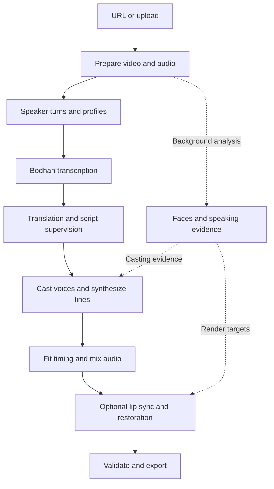
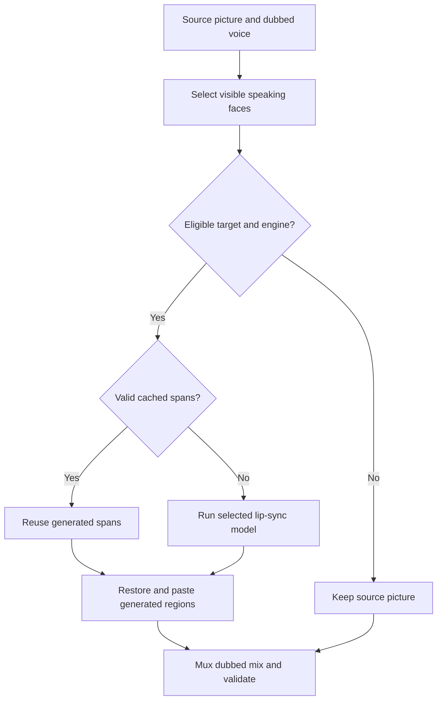

# Dubbing pipeline

The studio turns a URL or uploaded video into an editable dub. This guide follows `process_job()` in [jobs/pipeline.py](../backend/jobs/pipeline.py), which calls the stage modules in [jobs/stages/](../backend/jobs/stages/) in order; background stages can overlap. [config.py](../backend/config.py) and [`.env.example`](../.env.example) define configuration.

[Recording guide](CODE_WALKTHROUGH.md)

## Request and execution

1. Vue's `CreatePanel.vue` submits JSON to `POST /api/jobs`, or multipart data to `POST /api/jobs/upload`.
2. `backend/api/jobs.py` validates options, persists a queued job and schedules it in an executor. It returns a job ID.
3. `JobStore` in `backend/jobs/store.py` persists `jobs/<id>/status.json`. `JobControl` in `backend/jobs/control.py` manages cancellation and child processes. The browser subscribes to `/api/jobs/{id}/events` for progress.
4. `run_job()` manages attempts; `process_job()` runs the stages and reuses valid intermediate results. The stages share one `DubRun` (`backend/jobs/context.py`) holding the job's options and what each stage hands on.
5. The API serves output, reports, edits and history from the job directory.

`JOB_WORKERS` limits concurrent jobs. `RENDER_WORKERS` and `backend/jobs/gpus.py` bound expensive model work. Workers use separate environments to isolate incompatible dependencies.

## Processing phases

Code paths below are relative to `backend/`. `Segment` records in `models.py` carry timing, speaker, transcript, translation, voice and provenance through the phases.

| Phase | Code | Work and result |
| --- | --- | --- |
| 1. Source | `jobs/stages/source.py`; `media/video_input.py` | Validate URL/upload or reuse a saved source; apply clip range; prepare video, metadata and poster. `MAX_VIDEO_HEIGHT` controls resolution, up to 2160. |
| 2. Audio | `jobs/stages/source.py`, `jobs/stages/background.py`; `media/separation.py` | Extract speech audio; optionally separate vocals and background. |
| 3. Speakers | `jobs/stages/speakers.py`; `speakers/diarization.py`, `speaker_profiles.py`, `speaker_review.py`, `gender.py` | Detect turns, refine boundaries, review ownership and build speaker profiles. |
| 4. Faces | `jobs/stages/background.py`; `speakers/speaker_faces.py`, `rendering/face_analysis.py`, `workers/` | Cache faces, identities, speaking evidence and hand occlusions in the background. |
| 5. ASR | `jobs/stages/script.py`; `speech/asr.py`, `providers/bodhan_api.py` | Transcribe speech slots with Indic-Transcribe; check degenerate/script-mismatched results and optionally review transcripts. |
| 6. Translation/script | `jobs/stages/script.py`; `speech/translation.py`, `llm_translation.py`, `script_supervisor.py` | Translate lines, optionally post-edit with context, and estimate wording that fits. Preserve machine translations. |
| 7. Casting/voice | `jobs/stages/speakers.py`, `jobs/stages/voicing.py`; `voices/assignment.py`, `library.py`, `engine.py`; `speech/tts.py` | Match voices using language, profiles and user choices; incorporate face evidence; synthesize a WAV per line. |
| 8. Fit | `jobs/stages/voicing.py`; `speech/fitting.py`, `media/timeline.py` | Measure durations, rephrase/re-voice eligible lines and plan bounded tempo changes. |
| 9. Mix | `jobs/stages/mix.py`; `media/audio_merge.py`, `audio_norm.py` | Level and place clips, mix the background and normalize output. Write the delivered mix and voice-only track. |
| 10. Lip sync | `jobs/stages/render.py`; `rendering/lip_sync.py`, `latentsync.py`, `wav2lip.py`, `finish.py`, `mouth_enhance.py`; `workers/` | Redraw eligible speaking faces, restore generated regions and assemble video. Voice-only mode retains the source picture. |
| 11. Delivery | `media/media_validation.py`, `video_input.py`, `subtitles.py`, `shorts.py` | Validate export; create a preview when needed; deliver video/audio/subtitles and optional vertical shorts. |

## Models and services

These are project configuration identifiers. Provider availability and the environment determine which path runs.

| Purpose | Model/service | Execution |
| --- | --- | --- |
| ASR | Bodhan `indic-transcribe` | API |
| Translation | Bodhan `indic-translate` | API |
| Studio voices | Bodhan `indic-speak` | API |
| Script editing and speaker review | `OPENROUTER_MODEL`; default `google/gemini-3.8-flash`, with configured fallbacks | OpenRouter API |
| Optional ASR/TTS fallback | `OPENROUTER_ASR_MODEL`, `OPENROUTER_ASR_CHAT_MODEL`, `OPENROUTER_TTS_MODEL` | API; gated by provider policy |
| Voice cloning | `OPENROUTER_CLONE_MODEL`; default `fish-audio/s2.1-pro` | OpenRouter API, clone mode |
| Diarization | DiariZen WavLM-Large v2 + VBx, WeSpeaker ResNet34-LM embeddings | `.venv-diarizen` |
| Diarization alternatives | sherpa-onnx pyannote segmentation + CAM++; optional SpeechBrain | Studio/worker |
| Separation | Demucs `htdemucs`, or configured Mel-RoFormer via audio-separator | Studio / `.venv-separate` |
| Gender evidence | `audeering/wav2vec2-large-robust-6-ft-age-gender`, pitch, reviewer and face evidence | Worker and studio voting |
| Faces/speaking evidence | InsightFace `buffalo_l`, Light-ASD, MediaPipe Hands | `.venv-latentsync` / `.venv-hands` |
| Lip sync | LatentSync 1.6, Whisper-tiny features, SD VAE ft-mse | `.venv-latentsync`, CUDA |
| Lip-sync fallback | Wav2Lip / Wav2Lip-GAN, S3FD, optional OpenVINO | Configured interpreter |
| Restoration | GFPGAN v1.4, Real-ESRGAN general-x4v3 | `.venv-restore` / configured environment |
| Tempo/mixing/export | FFmpeg with Rubber Band | Local process |

`scripts/setup_models.sh` pins external checkouts and prepares environments and weights. Voice data is in `backend/voices/data/`. See [bundled implementations](VENDORED_CODE.md) before changing vendor code or model paths.

## Provider policy

`BODHAN_ONLY=true` keeps recognition, translation and studio voices on Bodhan, including rate-limit waiting. It still allows configured OpenRouter speaker review and script editing. When fallback is enabled, speech modules select configured alternatives; `voices/engine.py` maintains a consistent voice engine within the project.

Provider clients handle authentication, retries and response validation. `providers/usage.py` records job usage. Credentials belong in the untracked `.env`.

## Timing and audio

- `speech/fitting.py` compares speech duration with its slot. It can revise wording and retain a better-fitting take within `FIT_MIN_SPEED`, `FIT_MAX_SPEED` and `FIT_ROUNDS`.
- Rewrite guards protect names, figures and terms. User-edited lines retain their wording. The editor shows a live timing estimate.
- `media/timeline.py` plans placement. Exact mode uses `PACE_MIN`/`PACE_MAX`, can borrow following silence and limits excessive stretch; natural mode uses its own bounds. Lines can still end early or need trimming, so timing issues remain visible for review.
- `media/audio_norm.py` uses the preserved vendor normalizer to level clips and limit peaks. `media/audio_merge.py` applies pitch-preserving stretch, fades, background ducking and final normalization.
- `dubbed_voice.wav` drives lip sync; `dubbed_audio.wav` includes the chosen background and is the delivered mix.

## Lip sync and caching

Face analysis identifies who is visibly speaking. Target selection rejects unsuitable small/profile faces and excludes covered mouths using hand evidence. Off-screen narration and listener faces do not need a generated mouth.

LatentSync uses aligned face crops and temporal windows. The worker caches spans by picture, landmarks, local audio features and settings. A line edit can reuse unchanged spans. `rendering/finish.py` restores changed spans, pastes generated lower-face regions into the source and encodes the result. Configuration and face size determine GFPGAN/Real-ESRGAN restoration.

`LATENTSYNC_STEPS`, `LATENTSYNC_GUIDANCE`, `LATENTSYNC_DEEPCACHE` and restoration settings affect quality and speed. `rendering/lip_models.py` selects available engines. The report records eligible/synced frames, line-level face decisions and export checks.

## Edits, resume and history

| Action | API suffix under `/api/jobs/{id}` | Work repeated |
| --- | --- | --- |
| Change voices, delivery, engine or background | `POST /revoice` | Affected voices, fitting, mixing and rendering; valid caches reused |
| Edit script | `POST /script` | Affected translation/voice work and downstream output |
| AI rewrite | `POST /rewrite` | Proposal; accepted edits applied through `/script` |
| Generate/select take | `POST /lines/{i}/takes`, `/take` | Generate/select audio, then apply with a re-render |
| Merge speakers | `POST /speakers/{speaker}/merge` | Relabel state and regenerate affected output |
| Stop/continue | `POST /cancel`, `/resume` | Cancel processes or resume reusable work |
| Make short | `POST /shorts` | Crop/pad finished video; burn in subtitle cues when asked |

A new job can reuse prepared source through `POST /api/jobs` with `source_job`.

`jobs/versions.py` archives the completed render before replacement. `versions/<n>/` stores its media, script and settings. The UI presents owner changes; maintenance renders can refresh an associated entry. Version endpoints retain access to archived files.

Lines also retain previous wording and provenance. Restore applies an edit without erasing history. Persisted stages support resume; input/settings stamps invalidate affected caches.

## Job files

| Files under `jobs/<id>/` | Purpose |
| --- | --- |
| `status.json` | State, segments, settings, usage and progress |
| `source.mp4`, `source_audio.wav`, `poster.jpg` | Prepared source |
| `vocals.wav`, `background.wav` | Reusable stems |
| `speaker_turns*.json`, `gender.json`, `faces.npz`, `asd.npz` | Speaker/face analysis and stamps |
| `tts_NNNN.wav` | Generated speech |
| `dubbed_voice.wav`, `dubbed_audio.wav` | Voice timing track and delivered mix |
| `targets.npz`, `latentsync_cache/` | Targets and reusable rendered/restored spans |
| `dubbed_video.mp4`, `preview_video.mp4`, `lip_sync_report.json` | Master, optional preview and report |
| `versions/` | Archived renders and metadata |

Temporary fitting/mixing files are cleaned when unnecessary. Persistent media, weights, environments and caches stay out of Git. Unit tests cover contracts, timing, history and mocked model paths; real-media checks are still needed to assess model quality.
